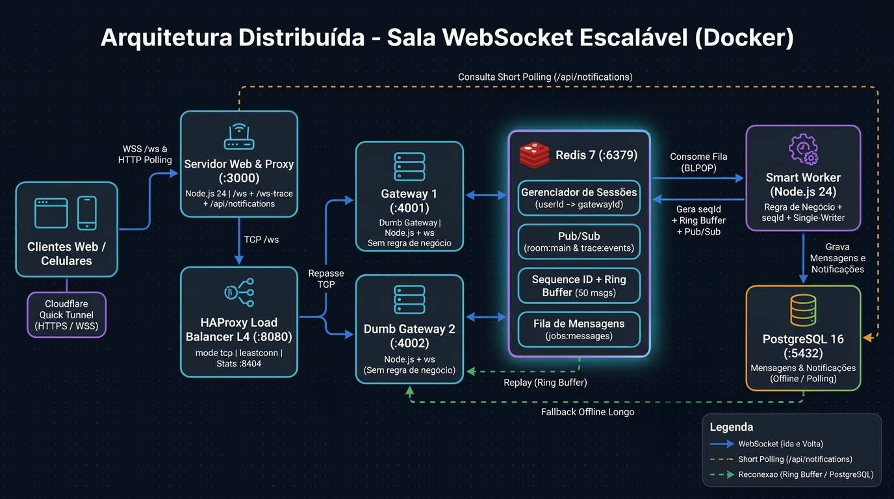

# PulseWS — Sala WebSocket Escalável em Sistemas Distribuídos

Protótipo funcional desenvolvido para a disciplina de **Sistemas Distribuídos**, implementando uma sala WebSocket única multi-usuário, painel comparativo de notificações via Short Polling e mapa visual SVG animado em tempo real com as rotas percorridas pelas mensagens.

## Arquitetura e Componentes



| Serviço | Tecnologia | Porta | Função |
| :--- | :--- | :--- | :--- |
| `web` | Node.js 24 (`node:http`, `ws`, `ioredis`, `pg`) | `3000` | UI interativa com SVG animado, proxy TCP `/ws -> haproxy:8080`, `/ws-trace` e Short Polling (`/api/notifications`) |
| `haproxy` | HAProxy 2.9 (`mode tcp`, `leastconn`) | `8080` / `8404` | Load Balancer Layer 4 (TCP passthrough), health check HTTP `/health`, `retries 3` + `redispatch` e painel Stats na `:8404` |
| `gateway-1` | Node.js 24 (`ws`, `ioredis`, `pg`) | `4001` (interna) | Dumb Gateway 1 (conexões WS, Session Manager, `gw:alive`, `maxPayload` 4 KB, rate limit, `XADD`, replay Ring Buffer/SQL paginado) |
| `gateway-2` | Node.js 24 (`ws`, `ioredis`, `pg`) | `4002` (interna) | Dumb Gateway 2 (escala horizontal e failover) |
| `worker-1` | Node.js 24 (`ioredis`, `pg`) | interna | Smart Worker (*Single-Writer*: consome Redis Streams, `seqId`, PostgreSQL idempotente, Ring Buffer, Pub/Sub e `XACK`) |
| `redis` | Redis 7 Alpine | `6379` (interna) | Session Manager, fila durável (Redis Streams `stream:jobs`), `seqId`, Ring Buffer (50 msgs), Pub/Sub (`room:main`, `trace:events`) e persistência AOF |
| `postgres` | PostgreSQL 16 Alpine | `5432` (interna) | Persistência durável (`messages` com `client_msg_id`, `notifications` e `room_meta`) |

## Pré-requisitos

- **Docker Desktop** aberto e em execução
- **Node.js 24+** (apenas para rodar os testes automatizados `npm test`)
- *(Opcional para turma conectar via celular)* **Cloudflare Tunnel (`cloudflared`)**

## Como Executar

1. Subir todos os 7 containers:
   ```bash
   docker compose up -d --build
   ```
2. Verificar saúde dos serviços:
   ```bash
   docker compose ps
   ```
3. Abrir a aplicação no navegador:
   - Interface principal (Chat + Mapa Animado + Short Polling): `http://localhost:3000`
   - Painel HAProxy Stats (`leastconn`): `http://localhost:8404`

## Testes Automatizados

Na raiz do repositório:
```bash
npm install
npm test            # validação funcional (L4, cross-gateway, Ring Buffer, Polling)
npm run test:fault  # injeção de falhas B1-B8 (reinicia/mata containers via docker compose)
```

## Roteiro de Testes Ao Vivo (Apresentação)

- **Reiniciar o Smart Worker sem derrubar conexões WebSocket (*Gateway Pattern*):**
  ```bash
  docker compose restart worker-1
  ```
- **Simular queda de um Gateway (*Failover* + *Ring Buffer*):**
  ```bash
  docker compose stop gateway-1
  ```
  *(Para religar depois: `docker compose start gateway-1`)*
- **Matar um Gateway à força e ver o navegador reconectar sozinho:**
  ```bash
  docker compose kill -s SIGKILL gateway-1
  ```
- **Expor gratuitamente na internet para os celulares da turma:**
  ```bash
  cloudflared tunnel --url http://localhost:3000
  ```
