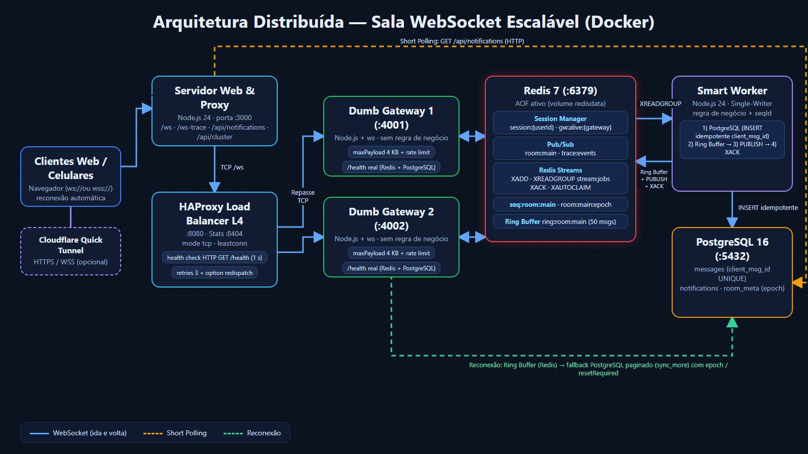
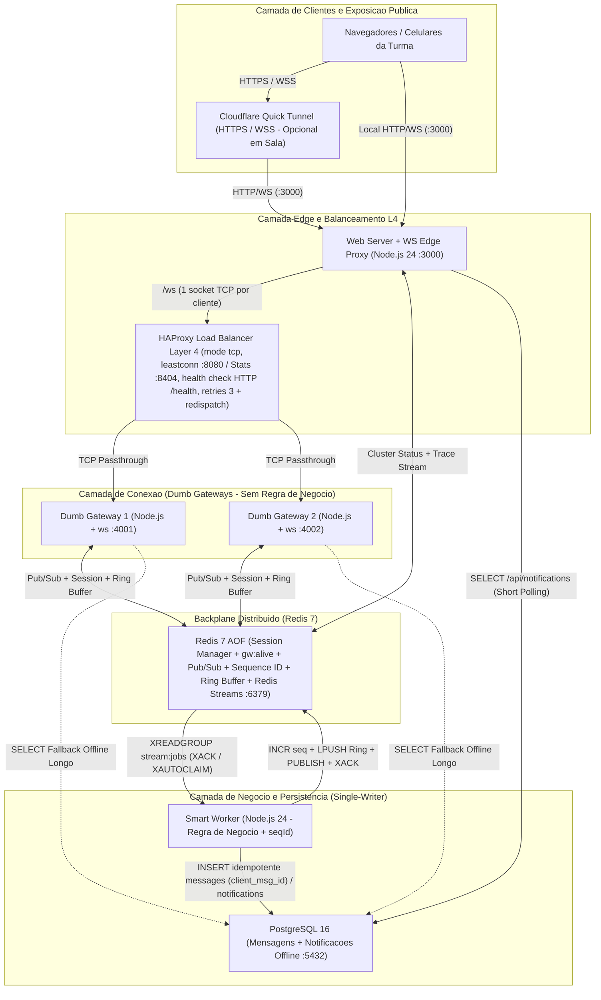

# Plano de Projeto — Sistemas Distribuídos: System Design de Sala WebSocket Escalável (Docker)

## Goal Description

Implementar um **protótipo funcional de Sistema Distribuído** orquestrado com **Docker Compose** (`HAProxy` + `Redis` + `PostgreSQL` + múltiplos serviços `Node.js 24 ESM`), fundamentado diretamente nos dois vídeos de *System Design* de WebSocket:

1. **Vídeo 1** — *Websocket, SSE e Polling: Atualizações em tempo real para entrevistas (System Design #4)* (Pedro Camaforte): trade-offs entre Polling e WebSockets (requisições "fantasmas" vs baixa latência bidirecional), Load Balancer **Layer 4 vs Layer 7**, comunicação entre múltiplos servidores via **Redis Pub/Sub** e persistência para usuários offline.
2. **Vídeo 2** — *WebSockets em Escala: Design de Sistemas* (Code with Lucian): **Gateway Pattern** (*Dumb Gateways* + *Smart Workers*), **Distributed Session Manager**, balanceamento **L4 (*Least Connections*)** sem timeouts agressivos de HTTP, e recuperação de reconexão via **Sequence IDs + Ring Buffer** em memória para evitar *thundering herd* no banco de dados.

### Escopo Fechado e Entregáveis do Protótipo

* **Sala WebSocket única (`room:main`) multi-usuário:** múltiplos clientes conectados simultaneamente (abas no PC ou celulares da turma via **Cloudflare Quick Tunnel** `wss://.../ws`).
* **Notificações via Short Polling:** endpoint real `GET /api/notifications` com contagem de requisições totais vs requisições vazias ("fantasmas") para comparação prática com o WebSocket.
* **Mapa Visual Interativo de System Design & Arquitetura (Frontend):** painel gráfico moderno exibindo **todos os servidores, tecnologias, portas e rotas**, com **animação ao vivo de pacotes indo e voltando** a cada evento real (e botão de **Replay em Câmera Lenta** para a apresentação de 10 minutos).

*(Relatório do AVA e roteiro cronometrado de 10 minutos serão produzidos em etapa posterior.)*

### Atualização — Resiliência e Tolerância a Falhas (branch `fix/resilience-fault-tolerance`)

Após testes de injeção de falhas (`B1`–`B8`) sobre a primeira versão, a arquitetura foi endurecida. Os pontos abaixo já estão refletidos nas seções seguintes e são verificados por `npm run test:fault`:

| ID | Falha injetada | Correção aplicada |
| :--- | :--- | :--- |
| `B1` | Reinício do Redis zerava `seq:room:main` e causava `messages_seq_id_key` | Redis com **AOF** (`redisdata`); Worker realinha `seq:room:main` com `MAX(seq_id)` do PostgreSQL; ordem **PostgreSQL → Ring Buffer → `PUBLISH` → `XACK`** |
| `B2` | Reconexão com `lastSeenSeqId` divergente retornava `up_to_date` | `epoch` da sala (`room_meta`), `resetRequired` e paginação `sync_more`; sessão recriada via `SET ... EX` no `pong` |
| `B3` | `SIGTERM` no Worker perdia o job em andamento | Shutdown gracioso aguarda o job atual (`inFlightJobPromise`) |
| `B4` | `kill -9` no Worker perdia mensagens (`BLPOP` *at-most-once*) | **Redis Streams** (`XADD`/`XREADGROUP`/`XACK`/`XAUTOCLAIM`) + `client_msg_id UNIQUE` (idempotência) |
| `B5` | Reinício do PostgreSQL derrubava `worker-1` e `web` | Listeners `error` em `pg.Pool`/Redis, `unhandledRejection` tratado e `restart: unless-stopped` |
| `B6` | `kill -9` no Gateway levava ~6,5 s e o front não reconectava | HAProxy com health check HTTP `/health`, `retries 3`, `option redispatch`; reconexão automática no front (backoff + jitter) |
| `B7` | Sessões fantasmas por até 45 s | Liveness `gw:alive:{gatewayId}` (TTL 6 s); `/api/cluster` filtra e limpa sessões órfãs |
| `B8` | Payload de 5 MB entrava no Redis, sem rate limit | `maxPayload` de 4 KB, validação (1–500 caracteres) e rate limit por conexão no Gateway |
| Extras | `KEYS session:*`, Pub/Sub sem ressincronização, SQL limitado a 200 | `SCAN`, resync ao reconectar o `redisSub`, fallback SQL paginado, validação de `userId` |

---

## Arquitetura da Solução e System Design



### 1. Diagrama Topológico (Servidores, Tecnologias e Portas)



---

### 2. Fluxo das Rotas (Ida, Volta, Polling e Reconexão)

```mermaid
sequenceDiagram
    participant C1 as "Cliente A (Gateway 1)"
    participant WEB as "Web Edge (:3000)"
    participant LB as "HAProxy L4 (:8080)"
    participant GW1 as "Gateway 1 (:4001)"
    participant RDS as "Redis 7 (:6379)"
    participant WK as "Smart Worker"
    participant PG as "PostgreSQL 16 (:5432)"
    participant GW2 as "Gateway 2 (:4002)"
    participant C2 as "Cliente B (Gateway 2)"

    Note over C1,C2: Rota 1 - Conexao e Balanceamento L4 (Least Connections)
    C1->>WEB: "GET /ws (Upgrade: websocket)"
    WEB->>LB: "Abre TCP dedicado (:8080)"
    LB->>GW1: "TCP Passthrough (leastconn)"
    GW1->>RDS: "SET session:alice gateway-1 EX 45"
    GW1-->>C1: "welcome (gatewayId=gateway-1, seqId)"

    Note over C1,C2: Rota 2 - Envio e Broadcast na Sala WebSocket (Ida e Volta)
    C1->>GW1: "WS frame: chat_message"
    GW1->>RDS: "XADD stream:jobs (clientMsgId)"
    WK->>RDS: "XREADGROUP stream:jobs"
    WK->>RDS: "INCR seq:room:main"
    WK->>PG: "INSERT INTO messages (ON CONFLICT client_msg_id DO NOTHING)"
    WK->>RDS: "LPUSH/LTRIM ring:room:main (somente apos o INSERT)"
    WK->>RDS: "PUBLISH room:main (payload + seqId) e XACK"
    RDS-->>GW1: "Pub/Sub entrega para Gateway 1"
    RDS-->>GW2: "Pub/Sub entrega para Gateway 2"
    GW1-->>C1: "WS push (seqId)"
    GW2-->>C2: "WS push (seqId)"

    Note over C2,PG: Rota 3 - Notificacoes via Short Polling (HTTP)
    C2->>WEB: "GET /api/notifications?afterId=10"
    WEB->>PG: "SELECT id > 10 FROM notifications"
    WEB-->>C2: "200 OK (novidades ou array vazio)"

    Note over C2,PG: Rota 4 - Queda e Reconexao (Ring Buffer vs PostgreSQL)
    C2->>GW2: "Reconecta com ?lastSeenSeqId=12"
    GW2->>RDS: "LRANGE ring:room:main (busca seqId > 12; confere epoch)"
    alt "Dentro da janela do Ring Buffer (ultimas 50)"
        GW2-->>C2: "sync (source=ring_buffer, zero query no DB)"
    else "Offline longo (fora do Ring Buffer)"
        GW2->>PG: "SELECT seq_id > 12 FROM messages (paginado, hasMore / sync_more)"
        GW2-->>C2: "sync (source=postgres_offline)"
    end
```

---

### 3. Inventário de Servidores, Tecnologias e Responsabilidades

| Servidor / Container | Imagem / Tecnologia | Porta | Protocolo | Papel na Arquitetura (Vídeos 1 e 2) |
| :--- | :--- | :--- | :--- | :--- |
| **`web`** | `node:24-alpine` (`node:http`, `ws`, `ioredis`, `pg`, HTML/CSS/JS + SVG) | `3000` | HTTP / WS Upgrade | Serve a UI animada, faz proxy de `/ws` para o HAProxy L4 (suporte a URL única + Cloudflare Tunnel), expõe `/ws-trace` e `/api/notifications`. |
| **`haproxy`** | `haproxy:2.9-alpine` | `8080` / `8404` | TCP L4 / HTTP Stats | **Load Balancer Layer 4 (`mode tcp`, `balance leastconn`)**. Roteia conexões brutas sem quebrar túneis WebSocket nem aplicar timeouts curtos de HTTP L7. Health check HTTP `GET /health` (1 s), `retries 3` e `option redispatch` para failover rápido. |
| **`gateway-1`** | `node:24-alpine` (`ws`, `ioredis`, `pg`) | `4001` | WebSocket / TCP | **Dumb Gateway 1**. Mantém conexões WS, heartbeat/TTL no Session Manager, publica `gw:alive:*`, assina `room:main`, enfileira com `XADD` e protege a borda (`maxPayload` 4 KB, rate limit, `/health` real). Zero regra de negócio. |
| **`gateway-2`** | `node:24-alpine` (`ws`, `ioredis`, `pg`) | `4002` | WebSocket / TCP | **Dumb Gateway 2**. Réplica idêntica para demonstrar escalabilidade horizontal, entrega cross-server e failover. |
| **`worker-1`** | `node:24-alpine` (`ioredis`, `pg`) | interna | Redis Streams / SQL | **Smart Worker**. Consome `stream:jobs` (consumer group), gera `seqId`, grava no PostgreSQL de forma idempotente, atualiza o Ring Buffer, publica e confirma com `XACK`. Shutdown gracioso; pode ser reiniciado sem derrubar sockets nos Gateways. |
| **`redis`** | `redis:7-alpine` | `6379` | RESP (TCP) | **Session Manager** (`session:*`), **Pub/Sub** (`room:main`, `trace:events`), **Sequence ID** (`seq:room:main`), **Ring Buffer** (`ring:room:main`), **Fila durável** (Redis Streams `stream:jobs`), liveness (`gw:alive:*`) e `room:main:epoch`. Persistência **AOF** no volume `redisdata`. |
| **`postgres`** | `postgres:16-alpine` | `5432` | TCP / SQL | Persistência durável de mensagens (`messages`, com `client_msg_id UNIQUE`), notificações (`notifications`) e `room_meta` (`epoch`), usada no Short Polling e fallback paginado de offline longo. |

---

### 4. Catálogo Completo de Rotas e Canais

| Rota / Canal | Origem -> Destino | Método / Tipo | Descrição |
| :--- | :--- | :--- | :--- |
| `GET /` | Cliente -> `web` | HTTP | Entrega a interface web (Chat + Mapa Animado + Polling + Cluster). |
| `UPGRADE /ws` | Cliente -> `web` -> `haproxy:8080` | WebSocket (`ws://` / `wss://`) | Conexão da sala única (`?userId=...&lastSeenSeqId=...&epoch=...`). Cada cliente abre um socket TCP independente no L4. |
| `UPGRADE /ws-trace` | Cliente -> `web` | WebSocket | Stream exclusivo de telemetria (`trace_hop`) para animar as rotas das mensagens no SVG em tempo real. |
| `GET /api/notifications?afterId=N` | Cliente -> `web` -> `postgres` | HTTP (Short Polling) | Busca notificações mais recentes que `N`; retorna vazio quando não há novidade (contabiliza requisições "fantasmas"). |
| `GET /api/cluster` | Cliente -> `web` -> `redis` | HTTP JSON | Retorna sessões ativas por Gateway (`gateway-1` vs `gateway-2`), `seqId` atual e tamanho do Ring Buffer; ignora e limpa sessões de Gateways sem `gw:alive:*`. |
| `http://localhost:8404` | Apresentador -> `haproxy` | HTTP (HAProxy Stats) | Painel nativo do HAProxy mostrando em tempo real conexões `leastconn` e saúde de `gateway-1` / `gateway-2`. |
| `XADD / XREADGROUP / XACK stream:jobs` | `gateway-*` -> `redis` -> `worker-1` | Redis Streams | Desacopla recepção de socket do processamento de negócio (*Gateway Pattern*) com entrega *at-least-once* (`XAUTOCLAIM` recupera jobs de workers mortos). |
| `PUBLISH / SUBSCRIBE room:main` | `worker-1` -> `redis` -> `gateway-*` | Redis Pub/Sub | Entrega broadcast entre servidores para clientes em gateways diferentes. |
| `PUBLISH / SUBSCRIBE trace:events` | Todos os nós -> `redis` -> `web` | Redis Pub/Sub | Envia saltos reais (`from -> to`, protocolo, tempo) para animação ao vivo no frontend. |

---

## User Review Required

> [!IMPORTANT]
> **Pré-requisito para rodar o projeto:**
> Com a inclusão do Docker, você precisará apenas ter o **Docker Desktop** aberto/rodando na máquina para executar `docker compose up --build` (e, opcionalmente na apresentação em sala, `cloudflared tunnel --url http://localhost:3000` para a turma conectar pelos celulares).

---

## Proposed Changes

### Infraestrutura Docker & Banco de Dados

#### [NEW] `docker-compose.yml`
Orquestra os 7 serviços (`postgres`, `redis`, `haproxy`, `gateway-1`, `gateway-2`, `worker-1`, `web`) em rede interna `pulsews-net`, com `healthcheck` em `postgres` e `redis`, `restart: unless-stopped` em todos os serviços, Redis com AOF (`--appendonly yes`), volumes persistentes `pgdata` e `redisdata` e mapeamento das portas `3000` (Web + `/ws`), `8080` (HAProxy L4 direto) e `8404` (HAProxy Stats).

#### [NEW] `haproxy/haproxy.cfg`
Configuração oficial **Layer 4 (`mode tcp`)**:
- `frontend ws_frontend`: `bind *:8080`
- `backend ws_gateways`: `mode tcp`, `balance leastconn`, `retries 3`, `option redispatch`, `option httpchk` com `http-check send meth GET uri /health` e `http-check expect status 200`, `default-server inter 1s fall 2 rise 1`, `server gateway-1 gateway-1:4001 check`, `server gateway-2 gateway-2:4002 check` (`timeout connect 400ms`)
- `listen stats`: `bind *:8404`, `mode http`, `stats enable`, `stats uri /`

#### [NEW] `db/init.sql`
Cria as tabelas no PostgreSQL:
- `messages`: `id SERIAL PRIMARY KEY`, `seq_id BIGINT UNIQUE NOT NULL`, `user_id VARCHAR(64) NOT NULL`, `content TEXT NOT NULL`, `gateway_id VARCHAR(32) NOT NULL`, `client_msg_id VARCHAR(64) UNIQUE` (idempotência), `created_at TIMESTAMPTZ DEFAULT NOW()`.
- `notifications`: `id SERIAL PRIMARY KEY`, `type VARCHAR(32) NOT NULL`, `user_id VARCHAR(64) NOT NULL`, `message TEXT NOT NULL`, `created_at TIMESTAMPTZ DEFAULT NOW()`.
- `room_meta`: `id SMALLINT PRIMARY KEY (id = 1)`, `epoch VARCHAR(64) NOT NULL` (identifica a sala para detectar reset de estado no cliente).

---

### Pacote Compartilhado (`src/shared/`)

#### [NEW] `src/shared/constants.js`
Define chaves Redis (`session:{userId}`, `gw:alive:{gatewayId}`, `seq:room:main`, `ring:room:main`, `stream:jobs`, `room:main`, `room:main:epoch`, `trace:events`) e constantes (`RING_BUFFER_SIZE = 50`, `SESSION_TTL_SEC = 45`, `GW_ALIVE_TTL_SEC = 6`, `WS_MAX_PAYLOAD_BYTES = 4096`, rate limit).

#### [NEW] `src/shared/clients.js`
Helpers compartilhados e resilientes: `createRedisClient` / `createPgPool` (listeners `error` e reconexão com backoff), `scanKeys` (substitui `KEYS` por `SCAN`), `ensureDbSchema` (migração idempotente), `getOrLoadRoomEpoch` e `installProcessErrorHandlers`.

#### [NEW] `src/shared/trace.js`
Helper para publicar eventos padronizados em `trace:events` (`{ traceId, flow, step, from, to, protocol, detail, ts }`), permitindo rastrear na UI cada salto real de mensagens WebSocket, Polling e Reconexão.

---

### Serviços Node.js (`src/gateway/`, `src/worker/`, `src/web/`)

#### [NEW] `src/gateway/Dockerfile` & `src/gateway/package.json` & `src/gateway/src/index.js`
**Dumb Gateway** (`ws`, `ioredis`, `pg`):
- Aceita `?userId=...&lastSeenSeqId=...` no upgrade WebSocket.
- Valida `userId` (formato/tamanho) e usa `WebSocketServer` com `maxPayload` de 4 KB.
- Registra sessão no Redis (`SET session:{userId} ... EX 45`) e a recria a cada heartbeat (`ping`/`pong`) com `SET ... EX`, recuperando sessões após reinício do Redis. Publica `gw:alive:{GATEWAY_ID}` (TTL 6 s, a cada 2 s). `GET /health` valida Redis e PostgreSQL (`200`/`503`).
- Na reconexão com `lastSeenSeqId >= 0`: consulta `LRANGE ring:room:main 0 -1`; se o `lastSeenSeqId` ainda estiver coberto pelo Ring Buffer, devolve `sync` com `recoverySource: "ring_buffer"`; caso contrário, consulta o PostgreSQL (`SELECT ... WHERE seq_id > $1`) e devolve `recoverySource: "postgres_offline"` em páginas de 200 (`hasMore` / `sync_more`). Se o `epoch` divergir ou `lastSeenSeqId` for maior que o `seqId` atual, devolve `resetRequired: true`.
- Valida o conteúdo (1–500 caracteres), aplica rate limit por conexão e envia comandos com `XADD stream:jobs` (com `clientMsgId`); assina `room:main` para entregar aos sockets locais e ressincroniza clientes quando o `redisSub` reconecta.

#### [NEW] `src/worker/Dockerfile` & `src/worker/package.json` & `src/worker/src/index.js`
**Smart Worker** (`ioredis`, `pg`):
- Consome `stream:jobs` via `XREADGROUP` (consumer group `workers-group`), recupera pendentes no boot e com `XAUTOCLAIM`, e só confirma com `XACK` após concluir (sem derrubar conexões de clientes se o container for reiniciado!). No `SIGTERM`, aguarda o job em andamento.
- Para `chat`: realinha `seq:room:main` com `MAX(seq_id)` quando necessário, incrementa o `seqId`, persiste em `messages` de forma idempotente (`ON CONFLICT (client_msg_id) DO NOTHING`), **só então** grava no `ring:room:main` (`LPUSH` + `LTRIM 0 49`), publica em `room:main` e faz `XACK`.
- Para `user_joined` / `user_left`: grava notificação no PostgreSQL para o Short Polling capturar e emite trace.

#### [NEW] `src/web/Dockerfile` & `src/web/package.json` & `src/web/src/index.js`
**Web Edge Server** (`node:http`, `ws`, `ioredis`, `pg`):
- Serve `public/` na porta `3000`.
- Proxy TCP no evento `upgrade` para `/ws` -> `haproxy:8080` (mantendo 1 conexão TCP por cliente para o `leastconn` e compatibilidade total com `wss://<tunnel>.trycloudflare.com/ws`).
- WebSocket `/ws-trace` repassando `trace:events` do Redis para o diagrama animado.
- `GET /api/notifications?afterId=0`: Short Polling no PostgreSQL + emissão de trace de Polling.
- `GET /api/cluster`: lê chaves `session:*` com `SCAN`, descarta sessões de Gateways sem `gw:alive:*`, e retorna `seq:room:main` e tamanho de `ring:room:main`. `GET /health` valida Redis e PostgreSQL.

---

### Frontend Visual Bonito & Animado (`src/web/public/`)

#### [NEW] `src/web/public/index.html`
#### [NEW] `src/web/public/styles.css`
#### [NEW] `src/web/public/app.js`
Interface moderna (tema escuro estilo painel de engenharia/observabilidade) dividida em:
1. **Painel Principal — Mapa Vivo da Arquitetura & Rotas (SVG Interativo):**
   - Exibe cada servidor com nome, **tecnologia** (`Node.js`, `HAProxy L4`, `Redis 7`, `PostgreSQL 16`), **porta** e **badge de status/contagem**.
   - Anima pacotes coloridos percorrendo exatamente o caminho de ida e volta pelas setas SVG conforme eventos reais chegam de `/ws-trace`:
     - **Azul:** Rota WebSocket (`Cliente -> Web/Proxy -> HAProxy L4 -> Gateway -> Redis Queue -> Worker -> PostgreSQL + Ring Buffer -> Redis Pub/Sub -> Gateways 1 e 2 -> Clientes`).
     - **Âmbar:** Rota Short Polling (`Cliente -> Web -> PostgreSQL -> Cliente`).
     - **Verde:** Rota Reconexão (`Ring Buffer` ou fallback `PostgreSQL`).
   - Botão **"Replay Última Rota (Câmera Lenta)"** + painel lateral com o log passo a passo da rota (`traceId`).
2. **Sala WebSocket (`room:main`) + Simulador de Falhas:**
   - Conexão por nome de usuário, exibição do Gateway atribuído (`gateway-1` vs `gateway-2`), chat em tempo real com `#seqId`, botão **"Abrir Nova Aba"** e botão **"Simular Queda / Reconectar"** (mostrando se recuperou do `Ring Buffer` ou `PostgreSQL`).
3. **Painel de Notificações (Short Polling) & Cluster Map:**
   - Feed de notificações via Polling (`2.5s`) com contadores de **requisições totais** vs **requisições vazias ("fantasmas")**.
   - Tabela ao vivo de quem está conectado em `gateway-1` vs `gateway-2` segundo o *Distributed Session Manager* do Redis.

---

### Scripts de Teste & Documentação

#### [NEW] `package.json` (raiz) & `scripts/load-test.mjs`
- `npm test` executa `scripts/load-test.mjs` contra `http://localhost:3000` / `ws://localhost:3000/ws`, validando balanceamento L4 (`gateway-1` e `gateway-2`), broadcast cross-gateway, `seqId` crescente, replay no Ring Buffer, Short Polling e eventos em `/ws-trace`.

#### [NEW] `scripts/fault-test.mjs`
- `npm run test:fault` injeta falhas via `docker compose` (reinício de Redis/Worker/PostgreSQL, `SIGKILL` em Worker e Gateway, payload de 5 MB e flood) e valida `B1`–`B8` e a regressão do Redis parado.

#### [NEW] `README.md`
Guia rápido de comandos (`docker compose up -d --build`, `docker compose restart worker-1`, `docker compose stop gateway-1`, `cloudflared tunnel --url http://localhost:3000`, `npm test`) e acesso ao HAProxy Stats (`http://localhost:8404`).

---

## Verification Plan

### Automated Tests
1. Subir todos os containers:
   ```bash
   docker compose up -d --build
   ```
2. Verificar saúde dos 7 serviços:
   ```bash
   docker compose ps
   ```
3. Instalar `ws` na raiz para o script de teste e executar:
   ```bash
   npm install
   npm test
   ```
   Validando distribuição L4 `leastconn` entre `gateway-1` e `gateway-2`, troca de mensagens cross-gateway, ordenação por `seqId`, replay via `ring_buffer`, endpoint `/api/notifications` e stream `/ws-trace`.
4. Rodar a suíte de injeção de falhas (`B1`–`B8`):
   ```bash
   npm run test:fault
   ```
5. Testar resiliência do *Gateway Pattern* (Worker reinicia sem derrubar sockets):
   ```bash
   docker compose restart worker-1
   ```

### Manual Verification
1. Abrir `http://localhost:3000` em 2–3 abas (`Alice`, `Bob`, `Carol`) e confirmar a distribuição entre `gateway-1` e `gateway-2` (também visível em `http://localhost:8404`).
2. Enviar mensagens no chat e acompanhar no **Mapa Animado** o pacote percorrendo todos os servidores e voltando pelos dois gateways; testar o botão **"Replay Última Rota (Câmera Lenta)"**.
3. Observar as notificações no painel **Short Polling** e o contador de requisições vazias ("fantasmas").
4. Testar **"Simular Queda / Reconectar"** e conferir o badge de recuperação pelo **Ring Buffer**.
5. Testar reconexão automática: `docker compose kill -s SIGKILL gateway-1` e observar o navegador reconectando no `gateway-2` sem clique manual.
6. *(Para demonstração em sala)* Testar `cloudflared tunnel --url http://localhost:3000` e abrir a URL gerada no celular para confirmar interação no chat e animação ao vivo via `wss://.../ws`.
